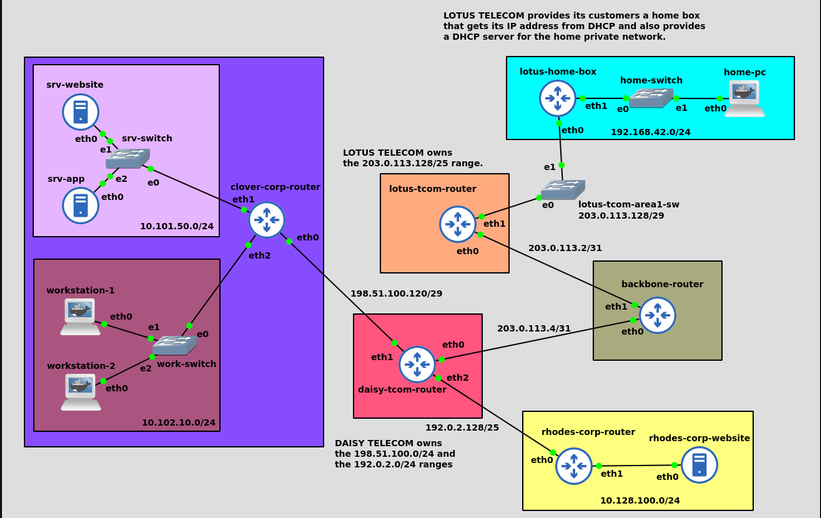

# Simulation d'un mini-Internet (GNS3)

Projet réseau réalisé dans le cadre de ma formation, simulant à petite échelle le fonctionnement d'Internet : entreprises, fournisseurs d'accès (FAI), backbone et client résidentiel, tous interconnectés avec un adressage IP public/privé réaliste.

## Objectif

Construire une topologie réseau complète mettant en œuvre :
- l'adressage IPv4 et le sous-réseautage (VLSM)
- le routage statique
- la translation d'adresses (NAT/SNAT/DNAT/MASQUERADE)
- le DHCP
- la segmentation réseau et le filtrage par pare-feu (firewall stateful)

L'idée est de reproduire une situation réaliste : des entreprises et des particuliers utilisent des adresses IP privées en interne, mais sont vus depuis l'extérieur avec une adresse IP publique fournie par leur FAI — exactement comme sur le vrai Internet.

## Architecture

Le réseau est composé de 6 entités interconnectées via un backbone central :

| Entité | Rôle | Détails |
|---|---|---|
| **Clover Corp.** | Entreprise avec serveurs exposés + postes de travail | 2 subnets (`10.101.50.0/24` serveurs, `10.102.10.0/24` postes), connectée via Daisy Telecom |
| **Rhodes Corp.** | Entreprise avec un seul serveur web | Subnet `10.128.100.0/24`, connectée via Daisy Telecom |
| **Daisy Telecom** | FAI professionnel | Fournit les ranges `198.51.100.0/24` et `192.0.2.0/24` à ses clients entreprises |
| **Lotus Telecom** | FAI grand public | Fournit le range `203.0.113.128/25`, découpé en sous-réseaux par zone géographique |
| **Client Lotus (home box)** | Particulier | Box avec IP publique obtenue en DHCP, réseau domestique `192.168.42.0/24` |
| **Backbone** | Cœur de réseau | Route le trafic entre les deux FAI sans connaître leur topologie interne |

##  Points techniques clés

- **Segmentation de sécurité chez Clover Corp.** : le pare-feu du routeur applique une logique de *deny-by-default* — tout ce qui n'est pas explicitement autorisé est bloqué. En particulier, le trafic du subnet serveurs vers le subnet postes de travail est refusé (sauf réponses à des connexions déjà établies), afin qu'un serveur exposé et compromis ne puisse pas rebondir vers le réseau interne des employés.
- **DNAT** : le trafic entrant sur le port TCP 80 est redirigé vers le serveur web interne (Clover Corp. et Rhodes Corp.).
- **SNAT / MASQUERADE** : les adresses privées sont traduites en adresse publique pour tout trafic sortant vers Internet. La box du particulier utilise `MASQUERADE` (et non un SNAT classique) car son IP publique est obtenue dynamiquement par DHCP.
- **DHCP à plusieurs niveaux** : les postes de travail de Clover Corp., les clients de Lotus Telecom (attribution d'IP publique) et les appareils du réseau domestique obtiennent tous leur configuration IP dynamiquement.
- **Routage au niveau du backbone** : le backbone ne route que sur les plages globales allouées à chaque FAI, sans connaître le détail de leurs sous-réseaux internes — comme un vrai cœur de réseau Internet.

## Technologies

- **GNS3** — simulation de la topologie réseau
- **Linux (conteneurs Docker GNS3)** — routeurs et hôtes
- **iptables** — règles de pare-feu et NAT
- **DHCP (isc-dhcp-server)** — attribution dynamique d'adresses

## Ce que j'ai appris

- Concevoir un plan d'adressage cohérent à plusieurs niveaux (entreprise, FAI, backbone)
- Différencier et implémenter SNAT, DNAT et MASQUERADE selon le contexte
- Mettre en place une segmentation réseau avec une vraie logique de sécurité (moindre privilège, exposition contrôlée d'un serveur)
- Comprendre le rôle d'un backbone qui agrège le routage sans se soucier de la topologie interne des FAI

## Ouvrir le projet

1. Installer [GNS3](https://www.gns3.com/) (GUI + VM/serveur local)
2. Importer le fichier [`project.gns3project`](./project.gns3project) via *File > Import appliance / Import project*
3. Démarrer les nœuds dans l'ordre : backbone → FAI → entreprises/particulier
4. Vérifier la connectivité avec `ping` et `traceroute` depuis les différents hôtes

## Suite du projet

Une version durcie de ce lab est en cours, intégrant **OPNsense** à la place du routeur Clover Corp., avec des règles de firewall auditées, un IDS/IPS (Suricata) et des scénarios de test d'intrusion pour valider la segmentation de sécurité. Voir le dépôt [nom-du-futur-repo] (à venir).
